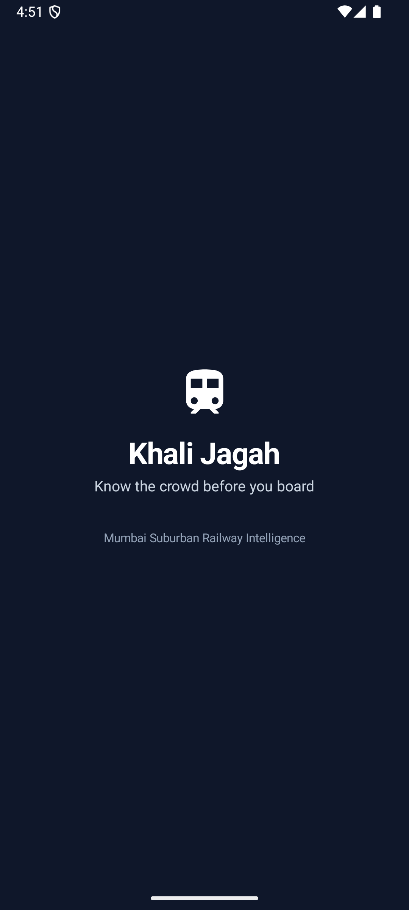
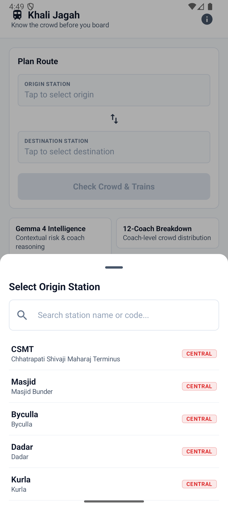
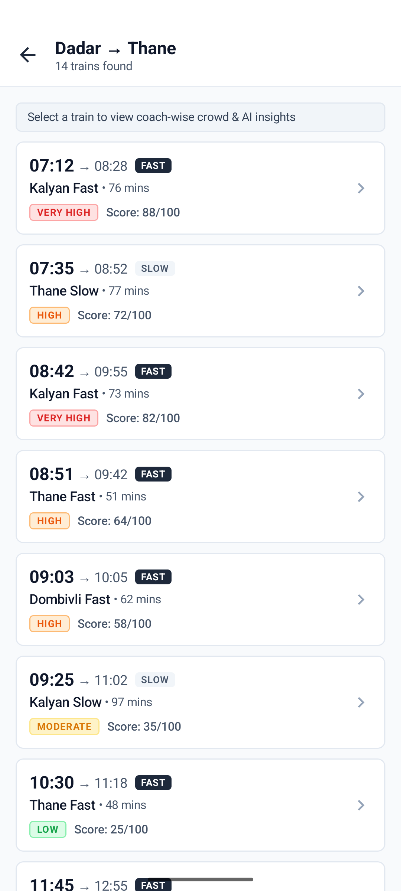
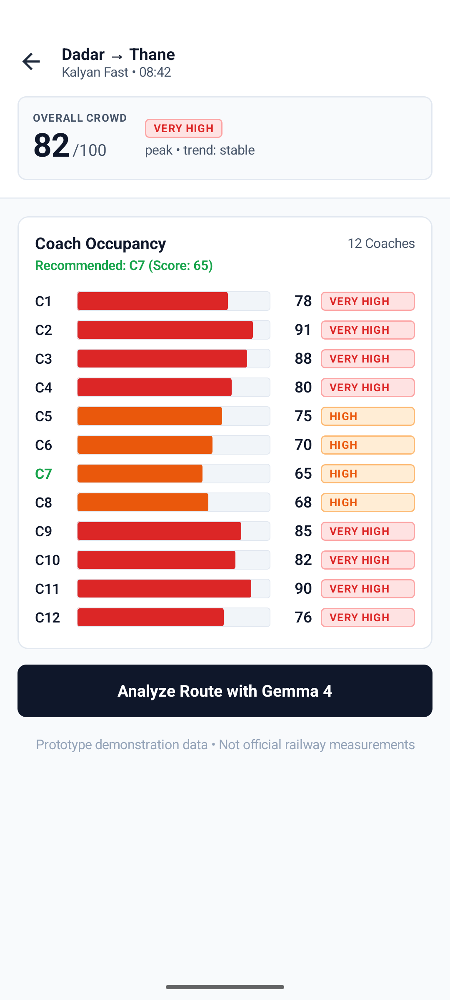
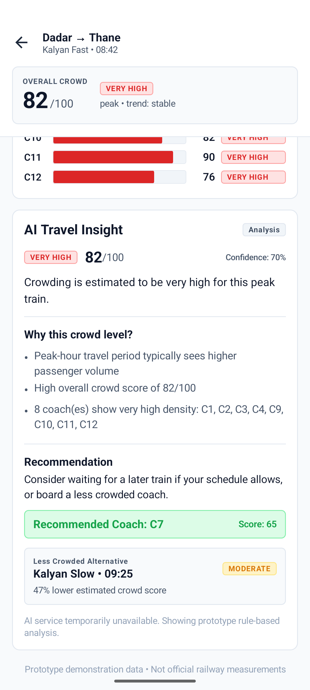
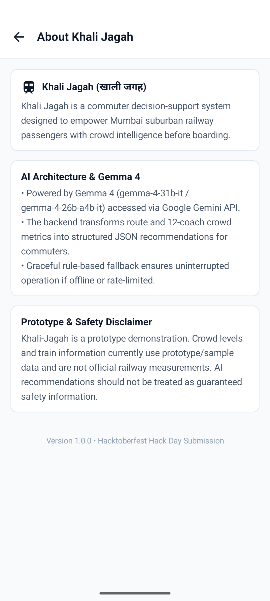
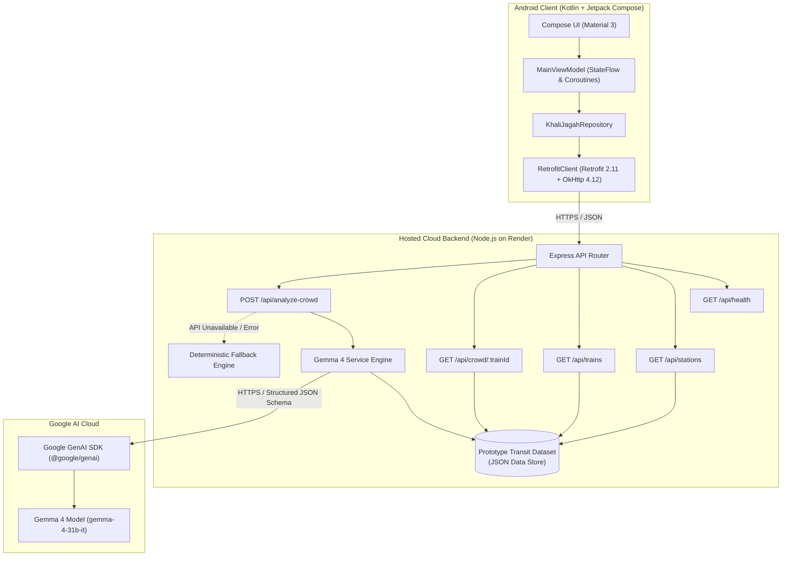

# 🚂 Khali-Jagah (खाली जगह)
### Mumbai Local Train Crowd Intelligence & AI Decision-Support System

[](LICENSE)
[](https://github.com/atharvakanekar22-dev/Khali-Jagah/releases/tag/v1.1.0)
[](https://ai.google.dev/)
[](https://ai.google.dev/)
[-46E3B7.svg)](https://khali-jagah-backend.onrender.com/api/health)
[](https://developer.android.com/jetpack/compose)

> **"Know the crowd before you board."**

---

## 🚀 Latest Release: v1.1.0

The **v1.1.0** release prepares Khali-Jagah for judging and independent evaluation on physical Android devices using the successfully deployed cloud backend:

* **Production Hosted HTTPS Backend**: The Android application is configured by default to connect to the deployed cloud backend at [`https://khali-jagah-backend.onrender.com`](https://khali-jagah-backend.onrender.com).
* **Zero Local Host Dependencies**: The production APK eliminates all requirements for `10.0.2.2`, laptop LAN IP addresses (`192.168.x.x`), USB debugging, ADB reverse port forwarding, or a locally running Node.js server.
* **Resilient Networking Timeouts**: Configured connect (20s) and read (60s) timeouts to seamlessly handle free-tier cloud cold-starts and multi-coach Gemma 4 inference.
* **Refined Recommendation Handling**: Enhanced schema deserialization for least-crowded coach identification (`coachName` supporting both `coach` and `id` formats) and lower-crowd alternative trains.
* **Honest Attribution**: The UI explicitly differentiates live **Gemma 4** reasoning (`source: "gemma-4"`) from the offline **Rule-Based Fallback** engine (`source: "rule-based-fallback"`).

📦 **Download the APK**: Download `app-debug.apk` directly from the [GitHub Releases Page](https://github.com/atharvakanekar22-dev/Khali-Jagah/releases/tag/v1.1.0).

---

## 📌 Problem Statement

Every single day, over **7.5 million commuters** rely on the Mumbai Suburban Railway network across the Central and Western lines. During morning and evening peak rush hours, trains routinely operate at more than **300% to 400% of their rated capacity** ("Super Dense Crush Load"), leading to dangerous platform surges, immense passenger anxiety, and severe carriage overcrowding.

Daily commuters face critical travel decisions with zero visibility:
* *Which train is likely to have manageable passenger volume?*
* *Which specific coach should I position myself for along a 270-meter platform?*
* *Is it worth waiting 10–15 minutes for a less crowded alternative service?*

**Khali-Jagah** ("Empty Space") addresses the **information and decision-support gap**. Rather than asking commuters to navigate raw numbers blindly, it synthesizes schedule data, historical peak patterns, and 12-coach density distributions into clear, actionable advice powered by **Google Gemma 4**.

---

## 💡 Solution Overview

Khali-Jagah is a native Android application built with modern **Jetpack Compose** backed by a **Node.js/Express** microservice that orchestrates transit data and prompts **Gemma 4 (`gemma-4-31b-it`)** via the **Google Gemini API** (`@google/genai` SDK).

```
Station Selection ➔ Train & Schedule Overview ➔ 12-Coach Crowd Breakdown ➔ Gemma 4 AI Analysis ➔ Actionable Commuter Decision
```

---

## ✨ Key Features

1. **Station & Route Selection**:
   * Covers major Central and Western suburban stations (CSMT, Byculla, Dadar, Kurla, Ghatkopar, Vikhroli, Bhandup, Mulund, Thane, Dombivli, Kalyan, Churchgate, Andheri, Borivali).
   * Real-time search with instant substring matching and line tags (`CENTRAL` / `WESTERN`).
   * One-tap source and destination station swap.

2. **Train Schedule & Crowd Overview**:
   * Complete timetable listings for Fast and Slow local services.
   * Departure and arrival times, journey durations, intermediate stops, and overall crowd severity indicators.
   * Clear visual distinction between Fast and Slow services.

3. **12-Coach Granular Visualization**:
   * Visual density bars (`CoachCrowdBar`) for all 12 coaches (C1 to C12).
   * Accessible, high-contrast indicators paired with semantic textual levels (`LOW`, `MODERATE`, `HIGH`, `VERY HIGH`).
   * Automatic highlighting of the least crowded coach (*Best Coach*) and heavily congested coaches.

4. **AI Travel Insight (Powered by Gemma 4)**:
   * **Contextual Synthesis**: Ingests route, departure window, overall congestion score, coach occupancy spread, and alternative options.
   * **Structured Reasoning**: Generates 2–4 concise bullet points explaining *why* the crowding pattern occurs.
   * **Actionable Recommendation**: Suggests a specific boarding tactic (e.g., coach position or schedule shift).
   * **Alternative Train Comparison**: Evaluates nearby departures on the same corridor and calculates expected crowd score reductions.

5. **Deterministic Offline Fallback Engine**:
   * If the Gemini API is unreachable, rate-limited, or during connectivity disruptions, a deterministic rule-based analysis engine produces structured recommendations without interrupting the user experience.

6. **Prototype Transparency & Safety**:
   * Clear disclaimers across all screens confirming the prototype nature of the demonstration data.

---

## 📱 Screenshots

The application workflow across key user journeys:

| 1. Home Dashboard | 2. Station Selector | 3. Train Results |
| :---: | :---: | :---: |
|  |  |  |

| 4. 12-Coach Density | 5. Gemma 4 AI Travel Insight | 6. About & System Architecture |
| :---: | :---: | :---: |
|  |  |  |

---

## 🏗️ Technical Architecture & Data Flow

### End-to-End System Architecture



### Complete Request & AI Inference Flow

```
Android Client (Compose UI)
        │
        ▼
   Retrofit 2.11 (HTTPS POST /api/analyze-crowd)
        │
        ▼
   Render Hosted Backend (Node.js / Express)
        │
        ├─► Aggregates Train Profile + 12-Coach Metrics + Candidate Alternatives
        │
        ▼
   Gemma 4 Service Engine (@google/genai SDK)
        │
        ├─► Injects Guardrail System Prompt & Typed JSON Schema
        │
        ▼
   Google Gemini API (Model: gemma-4-31b-it)
        │
        ▼
   Typed JSON Response
   { crowdLevel, crowdScore, confidence, summary, reasoning, recommendation, bestCoach, alternative }
        │
        ▼
   Backend Wraps Response & Emits HTTP 200
        │
        ▼
   Android Client Deserializes Response & Renders AI Travel Insight Card
```

---

## 🛠️ Technology Stack

| Component | Technology | Purpose |
| :--- | :--- | :--- |
| **Android Client** | Kotlin 2.1.20 | Primary language |
| | Jetpack Compose & Material 3 | Modern declarative UI design system |
| | Navigation Compose 2.9.0 | Single-activity screen navigation |
| | ViewModel & StateFlow | Reactive unidirectional state architecture |
| | Retrofit 2.11.0 + OkHttp 4.12.0 | Asynchronous REST networking client |
| | kotlinx.serialization 1.8.1 | High-performance JSON serialization |
| **Backend API** | Node.js (v20+) & Express.js | REST routing & orchestration gateway |
| | `@google/genai` SDK | Official Google GenAI SDK for Gemini API integration |
| | `cors` & `dotenv` | Cross-origin headers & server configuration |
| | Hosted on Render | Fully managed cloud hosting with automated HTTPS |
| **AI / Inference** | Google Gemma 4 (`gemma-4-31b-it`) | Open reasoning model for transit decision intelligence |
| | Google Gemini API | Cloud inference execution |

---

## 🌐 Live Backend & API Endpoints

The production backend is hosted at:
**`https://khali-jagah-backend.onrender.com`**

| Method | Endpoint | Description | Sample Query / Body |
| :---: | :--- | :--- | :--- |
| `GET` | `/api/health` | Health status, version, and configured Gemma model | *None* |
| `GET` | `/api/stations` | Suburban railway stations (Central & Western lines) | Optional `?line=central` |
| `GET` | `/api/trains` | Available trains for a route | `?source=DR&destination=TN` |
| `GET` | `/api/crowd/:trainId` | 12-coach occupancy breakdown for a train | URL param: `:trainId` (e.g. `MUM-0842`) |
| `POST` | `/api/analyze-crowd` | Gemma 4 AI reasoning and travel recommendations | Body: `{"trainId": "MUM-0842"}` |

> [!NOTE]
> **Free-Tier Cold Starts**: The backend is hosted on Render's free tier, which enters a sleep state after a period of inactivity. The first request after sleep may experience a 15–30 second wake-up latency. The Android client's 20-second connect timeout and 60-second read timeout are designed to accommodate this seamlessly.

---

## 🤖 AI Integration & Fallback Behaviour

Khali-Jagah integrates **Gemma 4 (`gemma-4-31b-it`)** via the `@google/genai` SDK with strict JSON schema enforcement.

### 1. Guardrail System Instructions
The model is instructed with domain-specific guardrails:
* Ground reasoning strictly in the provided train schedule and coach density data.
* Never fabricate real-time platform sensor numbers, live GPS tracking, or official railway authority statements.
* Output structured JSON adhering strictly to the schema specification.

### 2. Structured Response Schema
```typescript
{
  crowdLevel: string;       // "LOW" | "MODERATE" | "HIGH" | "VERY_HIGH"
  crowdScore: number;       // 0 to 100
  confidence: number;       // 0.0 to 1.0
  summary: string;          // Concise contextual summary
  reasoning: string[];      // 2 to 4 bulleted reasons
  recommendation: string;   // Actionable boarding or scheduling recommendation
  bestCoach?: {
    coach: string;          // Coach identifier (e.g., "C7")
    score: number;          // Congestion score (e.g., 65)
    level: string;          // Density level (e.g., "HIGH")
  };
  alternative?: {
    trainId: string;        // Alternative train ID (e.g., "MUM-0925")
    trainName: string;      // Alternative name (e.g., "Kalyan Slow")
    departure: string;      // Departure time (e.g., "09:25")
    crowdScore: number;     // Crowd score (e.g., 35)
    crowdLevel: string;     // Crowd level (e.g., "MODERATE")
    difference: number;     // Score reduction percentage
    reason: string;
  };
}
```

### 3. Live Gemma 4 vs. Fallback Attribution
* **Live Inference**: When Gemma 4 processes the request successfully, the response sets `source: "gemma-4"` and `model: "gemma-4-31b-it"`. The Android app displays a distinct **`Gemma 4`** badge.
* **Deterministic Fallback**: If the API call fails or times out, the backend invokes `generateFallbackAnalysis()`. This rule-based engine computes metrics deterministically, sets `source: "rule-based-fallback"`, and the Android app displays a **`Rule-Based Fallback`** badge.
* **Honest Attribution**: Rule-based fallback responses and API errors are **never** presented as live AI inference.

---

## 🧪 Testing & Verification

The project has undergone rigorous verification across multiple levels:

1. **Android Unit Tests**:
   * **9 of 9 unit tests passed** in [ModelsSerializationTest.kt](file:///c:/Users/Atharva/OneDrive/Desktop/Projects/Khali-Jagah/android/app/src/test/java/com/khalijagah/app/data/model/ModelsSerializationTest.kt).
   * Verified JSON deserialization against real response payloads from all 5 deployed endpoints (`/api/health`, `/api/stations`, `/api/trains`, `/api/crowd/:trainId`, and `/api/analyze-crowd`).
   * Validated edge cases: missing alternative trains, null/empty coach recommendations, and client URL configuration.

2. **Hosted Endpoint Verification**:
   * Tested all 5 API endpoints directly against `https://khali-jagah-backend.onrender.com` via HTTPS.
   * Confirmed live Gemma 4 output generation, schema compliance, and fallback activation.

3. **Debug APK Build**:
   * Assembled cleanly using Gradle 9.5 and JDK 21 (`BUILD SUCCESSFUL in 15s`).
   * Output artifact: `android/app/build/outputs/apk/debug/app-debug.apk` (18.22 MB).

4. **Physical-Device Smoke Testing**:
   * Conducted on a physical **Realme Android smartphone** (running Android 14) with all local computer servers stopped and ADB reverse disabled.
   * Successfully verified independent station search, route selection, 12-coach density rendering, and live Gemma 4 AI Travel Insight generation over public cellular data and Wi-Fi.

---

## 📦 Android APK Download & Installation

### Option A: Download Pre-Built APK (Recommended for Judges)
1. Open the [Khali-Jagah GitHub Releases](https://github.com/atharvakanekar22-dev/Khali-Jagah/releases/tag/v1.1.0) page.
2. Under **Assets**, download **`app-debug.apk`**.
3. Install the APK on your Android device (ensure "Install from unknown sources" is enabled if prompted).

### Option B: Install via ADB
```bash
adb install -r android/app/build/outputs/apk/debug/app-debug.apk
```

---

## 💻 Local Development Setup

### Prerequisites
* **Node.js**: v18+ or v20+
* **Android Studio**: Ladybug / Meerkat (or Android SDK API 36 with CLI tools)
* **Java Development Kit**: JDK 17 or JDK 21 (Android Studio JBR recommended)
* **Google Gemini API Key**: Optional for local backend development; obtain from [Google AI Studio](https://aistudio.google.com/)

### Step 1: Clone the Repository
```bash
git clone https://github.com/atharvakanekar22-dev/Khali-Jagah.git
cd Khali-Jagah
```

### Step 2: Local Backend Setup (Optional)
```bash
cd backend
npm install
cp .env.example .env
```
Add your Gemini API key to `backend/.env`:
```env
GEMINI_API_KEY=your_gemini_api_key_here
GEMMA_MODEL=gemma-4-31b-it
PORT=3000
```
Start the server:
```bash
npm start
```

### Step 3: Android Build
By default, the Android app connects to the hosted cloud backend (`https://khali-jagah-backend.onrender.com`).
```powershell
cd android
.\gradlew.bat testDebugUnitTest
.\gradlew.bat assembleDebug
```
To build targeting a local backend instead, pass `-PlocalBackend=true`:
```powershell
.\gradlew.bat assembleDebug -PlocalBackend=true
```

---

## 🔒 Security & Secrets Management

* **Zero Secrets in APK**: The Android application codebase, configuration files, and compiled APK contain **no** API keys or secrets.
* **Server-Side API Key**: The `GEMINI_API_KEY` is maintained exclusively on the backend as a secure environment variable on Render.
* **Committed Files**: `.env`, `.env.local`, and build cache artifacts are protected by `.gitignore` and never committed.

---

## ⚠️ Prototype Data Disclaimer

> **Important Notice:**
> **Khali-Jagah** is an experimental hackathon prototype and commuter decision-support system. All train timetables, crowd scores, and coach-by-coach density metrics utilized in this application are simulated prototype data. They **do not** represent live sensor telemetry, official Indian Railways feeds, or Central/Western Railway authority measurements. Commuters must exercise personal discretion; AI recommendations are analytical estimates and must not be used as official transit safety or operational directives.

---

## 🔮 Future Roadmap

* [ ] **Crowdsourced Commuter Pulse**: Real-time platform check-ins and passenger density votes.
* [ ] **Multilingual Voice Assistance**: Hands-free route inquiries in Hindi, Marathi, and English using the Gemini Live API.
* [ ] **Intelligent Departure Alerts**: Personalized notifications when a preferred low-crowd alternative is departing soon.
* [ ] **Platform Accessibility Indicators**: Escalator, elevator, and ladies' compartment positioning indicators.

---

## 📄 License

This project is licensed under the [MIT License](LICENSE).
