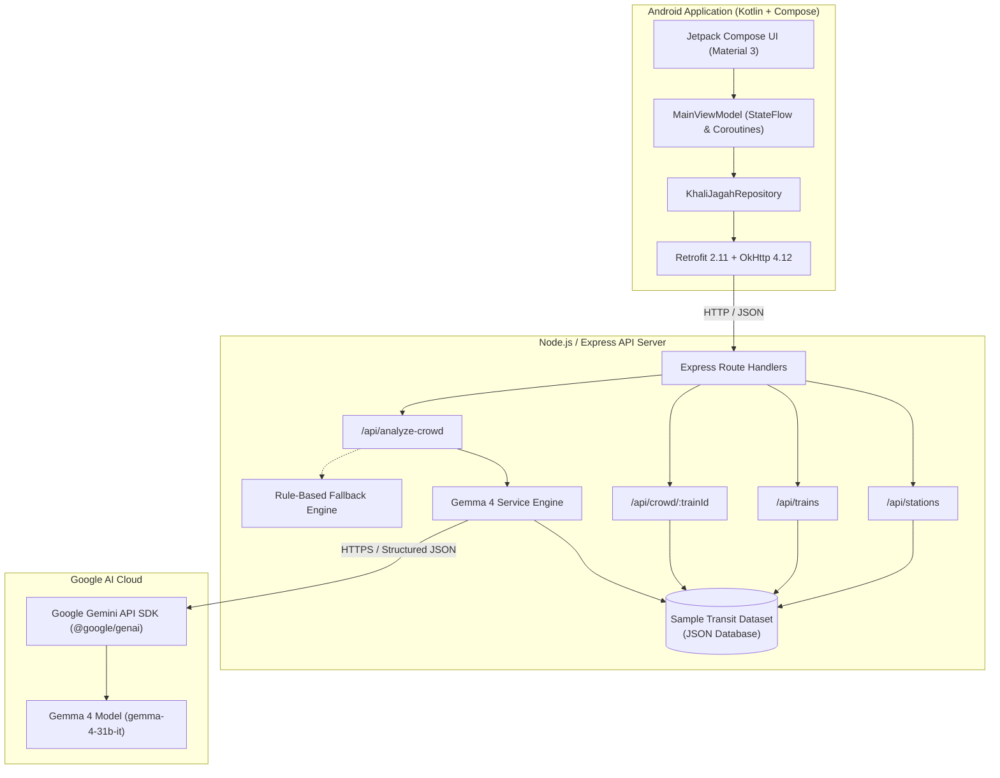

# 🚂 Khali-Jagah (खाली जगह)
### Mumbai Local Train Crowd Intelligence & AI Decision-Support System

[](LICENSE)
[](https://ai.google.dev/)
[](https://ai.google.dev/)
[](https://developer.android.com/jetpack/compose)

> **"Know the crowd before you board."**

---

## 📌 Problem Statement

Every day, over **7.5 million commuters** rely on the Mumbai Suburban Railway network. During peak morning and evening rush hours, trains frequently operate at more than **300% to 400% of their design capacity**, resulting in dangerous platform surges, severe carriage overcrowding, and immense passenger anxiety.

Commuters face critical daily decisions with zero visibility:
- *Which train is likely to be less crowded?*
- *Which coach should I position myself for on the platform?*
- *Is it worth waiting 10–15 minutes for a less congested alternative?*

**Khali-Jagah** ("Empty Space") does not attempt to physically expand railway tracks or build train cars. Instead, it solves the **information and decision-support gap** by providing commuters with AI-driven, coach-level crowd intelligence and actionable travel advice before they step onto the platform.

---

## 💡 Solution Overview

Khali-Jagah is a native Android application powered by **Google's Gemma 4** (via the Google Gemini API) and a lightweight Node.js/Express backend. It transforms raw, multidimensional transit metrics (historical occupancy, time-of-day peak patterns, train speed class, and coach-by-coach density) into structured, clear, and actionable commuting insights.

```
Station/Route Selection ➔ Train & Schedule Overview ➔ Coach-Wise Crowd Breakdown ➔ Gemma 4 AI Analysis ➔ Actionable Commuter Decision
```

---

## ✨ Key Features

1. **Station & Route Selection**:
   - Curated list of Central and Western line stations (CSMT, Byculla, Dadar, Kurla, Ghatkopar, Thane, Kalyan, etc.).
   - Instant search with real-time substring filtering and line tags (`CENTRAL` / `WESTERN`).
   - One-tap source/destination station swap.

2. **Train Schedule & Crowd Preview**:
   - Complete schedule listings for Fast and Slow local trains.
   - Departure/arrival timings, journey duration, and overall crowd severity indicators.
   - Clear distinction between *FAST* and *SLOW* services.

3. **12-Coach Granular Breakdown**:
   - Visual progress indicators (`CoachCrowdBar`) for all 12 coaches (C1 to C12).
   - High-contrast color coding supplemented with accessible text labels (`LOW`, `MODERATE`, `HIGH`, `VERY HIGH`).
   - Automatic identification of least crowded (*Best Coach*) and most congested coaches.

4. **AI Travel Insight (Powered by Gemma 4)**:
   - **Contextual Synthesis**: Ingests route, time period, overall crowd score, coach distribution, and alternative trains.
   - **Structured Reasoning**: Returns 2–4 bulleted rationale explaining *why* the crowding occurs.
   - **Personalized Recommendation**: Suggests the optimal boarding strategy.
   - **Alternative Train Comparison**: Evaluates nearby departures and suggests lower-crowd options with calculated crowd score reductions.

5. **Graceful Offline & Fallback Engine**:
   - Deterministic rule-based analytical engine mirroring the Gemma schema if the cloud AI service is temporarily unreachable or when API keys are not configured.

6. **Safety & Prototype Transparency**:
   - Explicit disclaimer labels across all screens ensuring users understand the prototype nature of the demonstration data.

---

## 🏗️ Technical Architecture

### End-to-End System Architecture



### Complete Request & Inference Flow

```
Android Client (Compose UI)
        │
        ▼
   Retrofit 2.11 (HTTP POST /api/analyze-crowd)
        │
        ▼
   Node.js / Express Backend
        │
        ├─► Aggregates Train Schedule + 12-Coach Density + Alternative Trains
        │
        ▼
   Gemma 4 Service (@google/genai SDK)
        │
        ├─► Injects Strict Transit System Prompt & Typed JSON Schema
        │
        ▼
   Google Gemini API (Model: gemma-4-31b-it)
        │
        ▼
   Structured JSON Analysis
   { crowdLevel, crowdScore, confidence, summary, reasoning, recommendation, bestCoach, alternative }
        │
        ▼
   Node.js Backend Response
        │
        ▼
   Android Client (AI Travel Insight Card Rendered)
```

---

## 🤖 How Gemma 4 Integration Works

Khali-Jagah utilizes the official **`@google/genai`** SDK to communicate with **Gemma 4 (`gemma-4-31b-it`)** hosted on the Google Gemini API.

### 1. Zero-Hallucination Transit Prompting
The model is constrained via system instructions to:
- Act strictly as an urban transit crowd-analysis assistant.
- Use **only** the provided structured train metrics.
- Never invent live GPS positions, sensor counts, or real-time platform measurements.
- Always provide structured reasoning and calculate alternative benefits from the supplied dataset.

### 2. Guaranteed JSON Schema Enforcement
The backend defines a strict schema using `@google/genai`'s `Type` definitions (`responseMimeType: "application/json"`, `responseJsonSchema: RESPONSE_SCHEMA`), guaranteeing deterministic typed outputs:

```typescript
{
  crowdLevel: string;       // "LOW" | "MODERATE" | "HIGH" | "VERY_HIGH"
  crowdScore: number;       // 0 to 100
  confidence: number;       // 0.0 to 1.0
  summary: string;          // Concise situation summary
  reasoning: string[];      // 2-4 bulleted reasons
  recommendation: string;   // Actionable advice for commuter
  bestCoach: {
    coach: string;          // e.g. "C7"
    score: number;          // e.g. 65
    level: string;          // e.g. "HIGH"
  };
  alternative?: {
    trainId: string;        // e.g. "MUM-0925"
    trainName: string;      // e.g. "Kalyan Slow"
    departure: string;      // e.g. "09:25"
    crowdScore: number;     // e.g. 35
    crowdLevel: string;     // e.g. "MODERATE"
    difference: number;     // e.g. 47 (% lower crowd)
    reason: string;
  };
}
```

---

## 📊 Verified Live Inference Example

During live testing with `GEMINI_API_KEY` configured and model `gemma-4-31b-it`:

* **Analyzed Train**: `MUM-0842` (Kalyan Fast departing Dadar at 08:42 AM)
* **Overall Score**: `82/100` (`VERY HIGH` — Peak Period)
* **Coach Density**: Coaches C2 (91), C3 (88), C11 (90) severely crowded; Coach C7 (65) least crowded.

### Live Response from `gemma-4-31b-it`:
```json
{
  "crowdLevel": "VERY_HIGH",
  "crowdScore": 82,
  "confidence": 0.9,
  "summary": "Expect severe crowding on the 08:42 Kalyan Fast as it operates during peak hours with high historical passenger density.",
  "reasoning": [
    "Operating during the morning peak travel window.",
    "Overall crowd score is very high at 82/100, consistent with a historical average of 80/100.",
    "Majority of coaches (e.g., C2 at 91/100, C11 at 90/100) exhibit extreme congestion levels."
  ],
  "recommendation": "Consider boarding coach C7 for relatively lower crowding (score 65), or switch to the 09:25 Kalyan Slow for significantly better comfort.",
  "bestCoach": {
    "coach": "C7",
    "score": 65,
    "level": "HIGH"
  },
  "alternative": {
    "trainId": "MUM-0925",
    "trainName": "Kalyan Slow",
    "departure": "09:25",
    "crowdScore": 35,
    "crowdLevel": "MODERATE",
    "difference": 47,
    "reason": "Significantly lower estimated crowd score (35/100 vs 82/100) providing a more comfortable journey."
  },
  "source": "gemma-4",
  "model": "gemma-4-31b-it",
  "disclaimer": "AI-generated estimate based on prototype dataset. Not official railway data."
}
```

---

## 🛠️ Technology Stack

| Layer | Technology | Purpose |
|---|---|---|
| **Android Client** | Kotlin 2.1.20 | Primary programming language |
| | Jetpack Compose & Material 3 | Modern declarative UI design system |
| | Navigation Compose 2.9.0 | Single-activity screen routing & state preservation |
| | ViewModel & StateFlow | Reactive unidirectional data flow (MVI / MVVM) |
| | Retrofit 2.11.0 + OkHttp 4.12.0 | Type-safe asynchronous HTTP client |
| | kotlinx.serialization 1.8.1 | High-performance JSON serialization |
| **Backend API** | Node.js (v20+) & Express.js | Lightweight REST API server |
| | `@google/genai` SDK | Official Google GenAI SDK for Gemini API & Gemma |
| | `dotenv` & `cors` | Environment isolation & cross-origin support |
| **AI / ML** | Google Gemma 4 (`gemma-4-31b-it`) | Open reasoning model for transit decision intelligence |
| | Google Gemini API | Cloud inference API infrastructure |

---

## 📏 Crowd Scoring Index

Khali-Jagah utilizes a normalized **0–100 Crowd Index**:

| Score Range | Crowd Level | Visual Indicator | Passenger Experience |
|---|---|---|---|
| **0 – 30** | `LOW` | 🟢 Green | Seats likely available; comfortable boarding |
| **31 – 55** | `MODERATE` | 🟡 Amber | Standing room comfortable; manageable boarding |
| **56 – 75** | `HIGH` | 🔴 Red | Packed carriage; expect tight standing space |
| **76 – 100** | `VERY HIGH` | 🟣 Dark Red | Severe rush; boarding difficult, consider alternatives |

---

## 🔌 API Endpoints Reference

| Method | Endpoint | Description | Query / Body Params |
|---|---|---|---|
| `GET` | `/api/health` | Service health, model status & key detection | None |
| `GET` | `/api/stations` | List of suburban stations | Optional `?line=central` or `?line=western` |
| `GET` | `/api/trains` | Available trains for a given route | `?source=DR&destination=TN` |
| `GET` | `/api/crowd/:trainId` | Coach-by-coach density for a specific train | URL parameter `trainId` (e.g. `MUM-0842`) |
| `POST` | `/api/analyze-crowd` | Gemma 4 AI reasoning and recommendation | Body: `{"trainId": "MUM-0842"}` |

---

## 🚀 Getting Started & Local Setup

### Prerequisites
- **Node.js**: v18+ or v20+
- **Android Studio**: Ladybug / Meerkat (or Android SDK API 36 with command-line tools)
- **Java Development Kit**: JDK 17
- **Google Gemini API Key**: Obtain a free API key from [Google AI Studio](https://aistudio.google.com/)

---

### Step 1: Clone Repository
```bash
git clone https://github.com/your-username/Khali-Jagah.git
cd Khali-Jagah
```

---

### Step 2: Backend Setup
1. Navigate to the backend directory and install dependencies:
   ```bash
   cd backend
   npm install
   ```

2. Create your `.env` configuration file from the template:
   ```bash
   cp .env.example .env
   ```

3. Open `backend/.env` and paste your Gemini API key:
   ```env
   GEMINI_API_KEY=your_actual_gemini_api_key_here
   GEMMA_MODEL=gemma-4-31b-it
   PORT=3000
   ```

4. Start the backend server:
   ```bash
   npm start
   ```
   *The server starts on `http://localhost:3000`. You will see the Khali Jagah startup banner confirming `API key: configured ✓`.*

---

### Step 3: Android App Setup & Build

1. Open `android/` in Android Studio **OR** build from the command line using the Gradle wrapper:
   ```powershell
   cd android
   .\gradlew.bat assembleDebug
   ```

2. **Network Endpoint Note**:
   - **Android Emulator**: The app is pre-configured to use `http://10.0.2.2:3000` (the Android emulator alias for host machine `localhost`).
   - **Physical Device**: If testing on a physical Android phone via Wi-Fi, update `BASE_URL` in `android/app/src/main/java/com/khalijagah/app/data/remote/RetrofitClient.kt` with your computer's local IP address (e.g., `http://192.168.1.50:3000`).

3. Install on your connected emulator or device:
   ```powershell
   & "$env:LOCALAPPDATA\Android\Sdk\platform-tools\adb.exe" install -r "android/app/build/outputs/apk/debug/app-debug.apk"
   & "$env:LOCALAPPDATA\Android\Sdk\platform-tools\adb.exe" shell am start -n com.khalijagah.app/.MainActivity
   ```

---

## 📱 2-Minute Judge Demo Walkthrough

1. **Launch App**: Open *Khali Jagah*. Observe the animated splash screen and transition to the Home dashboard.
2. **Select Route**:
   - Tap **FROM** ➔ Select **Dadar** (`DR`).
   - Tap **TO** ➔ Search & Select **Thane** (`TN`).
3. **Explore Trains**:
   - Tap **Check Crowd**.
   - Browse the 14 trains showing departure times, FAST/SLOW tags, and crowd badges.
4. **Inspect High-Crowd Train**:
   - Select **Kalyan Fast (08:42)** with score `82/100 VERY HIGH`.
   - Inspect the 12-coach visualization. Note that coach `C7 (65)` is flagged as the least congested coach.
5. **Generate AI Travel Insight**:
   - Tap **Get AI Travel Insight**.
   - Watch Gemma 4 analyze the coach occupancy and recommend boarding coach C7 or switching to the **09:25 Kalyan Slow** (`35/100 MODERATE`, a 47% crowd reduction).
6. **Review About Screen**:
   - Tap the Info icon in the top app bar to view the Gemma 4 system architecture, structured output pipeline, and dataset disclaimers.

---

## 🔒 Security & Secrets Management

- **Zero Client-Side Secrets**: The Android application codebase and compiled APK contain **NO** API keys or secrets.
- **Backend Isolation**: All Gemini API calls originate exclusively from the Node.js backend server.
- **Git Safety**: `backend/.env`, root `.env`, and all local build property files are strictly listed in `.gitignore` and must never be committed to source control.

---

## ⚠️ Prototype Data Disclaimer

> **Important Notice:**
> **Khali-Jagah** is an experimental prototype and decision-support demonstration created for Hacktoberfest. Train schedules, crowd scores, and coach distributions utilized in this MVP are simulated demonstration data and **do not** represent live sensor telemetry, official Indian Railways data, or Central/Western Railway authority metrics. Commuters must exercise personal judgment; AI recommendations should not be interpreted as absolute safety guarantees.

---

## 🔮 Future Roadmap

- [ ] **Crowdsourced Real-Time Pulse**: In-app passenger check-ins and platform density votes.
- [ ] **Live Voice Assistant**: Multilingual voice guidance (Hindi, Marathi, English) using Gemini Live API streaming.
- [ ] **Smart Push Notifications**: Personalized departure notifications based on learned commute patterns.
- [ ] **Accessibility Platform Mapping**: Elevator, escalator, and luggage compartment density indicators.

---

## 📄 License

This project is open-source and available under the [MIT License](LICENSE).
