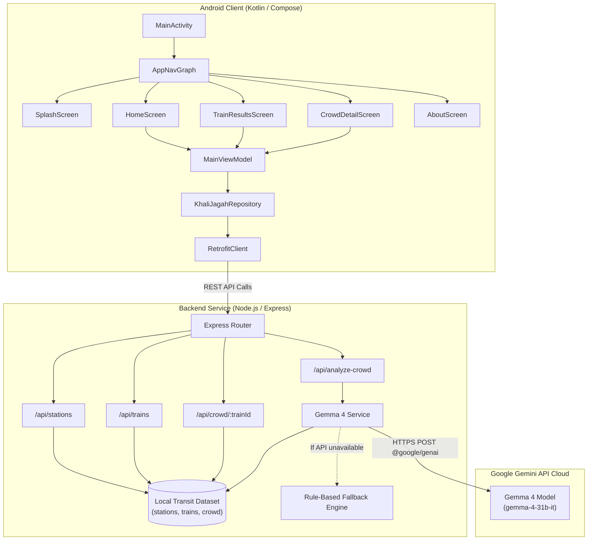

# 🏛️ Khali-Jagah Technical Architecture & Design Document

This document provides a detailed technical specification of the **Khali-Jagah** Mumbai Local Train Crowd Intelligence system.

---

## 1. System Overview

Khali-Jagah is divided into two discrete tiers:
1. **Android Client Tier**: A native Kotlin application built using Jetpack Compose and Material 3, following unidirectional data flow (UDF / MVVM).
2. **Backend & AI Tier**: A Node.js Express server acting as a secure gateway that aggregates simulated transit data, formats prompts, enforces typed schemas, and executes inference against **Google Gemma 4 (`gemma-4-31b-it`)** via the Google Gemini API (`@google/genai` SDK).

---

## 2. Component Architecture



---

## 3. Data Model Specification

### Station Object
```json
{
  "id": "DR",
  "name": "Dadar",
  "shortName": "Dadar",
  "line": "central",
  "order": 4
}
```

### Train Schedule Object
```json
{
  "id": "MUM-0842",
  "name": "Kalyan Fast",
  "type": "fast",
  "source": "CSMT",
  "destination": "KYN",
  "departure": "08:42",
  "arrival": "09:55",
  "journeyMinutes": 73,
  "stops": ["CSMT", "BY", "DR", "CLA", "GC", "TNA", "DI", "KYN"]
}
```

### 12-Coach Crowd Record
```json
{
  "trainId": "MUM-0842",
  "period": "peak",
  "overallCrowdScore": 82,
  "coaches": {
    "C1": 78,
    "C2": 91,
    "C3": 88,
    "C4": 80,
    "C5": 75,
    "C6": 70,
    "C7": 65,
    "C8": 68,
    "C9": 85,
    "C10": 82,
    "C11": 90,
    "C12": 76
  },
  "historicalAvg": 80,
  "trend": "stable"
}
```

---

## 4. Gemma 4 Prompt Engineering & Schema Enforcement

The backend uses `@google/genai` to enforce structured JSON output:

```javascript
const response = await genAI.models.generateContent({
  model: "gemma-4-31b-it",
  contents: userPrompt,
  config: {
    systemInstruction: SYSTEM_PROMPT,
    responseMimeType: "application/json",
    responseJsonSchema: RESPONSE_SCHEMA,
    temperature: 0.3,
    maxOutputTokens: 1024,
  },
});
```

### Guardrail System Prompt
The model is instructed with strict guardrails:
1. Grounding exclusively in provided parameters.
2. Explicit recognition that all data represents prototype simulations.
3. No assertion of live sensor counts or official railway authority tracking.
4. Output must be strictly valid JSON without markdown wrapping.

---

## 5. Offline Fallback Resilience

If the Gemini API key is missing or the external network is unreachable:
1. `gemmaService.js` catches the error.
2. The request is routed to `fallback.js`.
3. A deterministic rule-based analysis calculates crowd levels, identifies the least crowded coach, locates alternative trains with $\ge 10$ points lower crowd score, and formats the output matching the exact schema with `"source": "rule-based-fallback"`.

---

## 6. Android UI State Architecture

The Android application implements a reactive state machine inside `MainViewModel`:

```kotlin
data class AppUiState(
    val stations: List<Station> = emptyList(),
    val stationsLoading: Boolean = false,
    val stationsError: String? = null,
    val sourceStation: Station? = null,
    val destStation: Station? = null,
    val trains: List<TrainResult> = emptyList(),
    val trainsLoading: Boolean = false,
    val trainsError: String? = null,
    val selectedTrain: TrainResult? = null,
    val crowdData: CrowdResponse? = null,
    val crowdLoading: Boolean = false,
    val crowdError: String? = null,
    val analysisResult: AnalyzeResponse? = null,
    val analysisLoading: Boolean = false,
    val analysisError: String? = null
)
```

All state mutations occur on `viewModelScope` using coroutines and emit through `StateFlow<AppUiState>`, ensuring seamless composition lifecycles and configuration changes.
